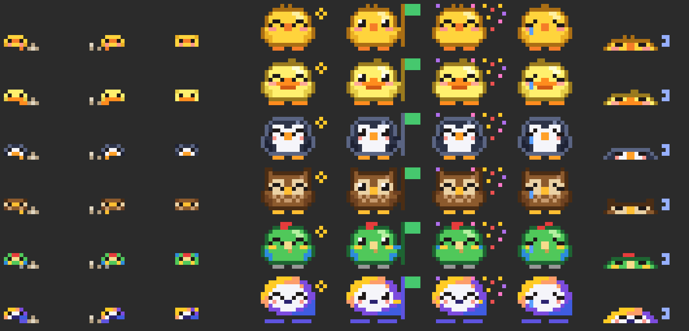

# chick-status

Claude Code 的像素宠物 mod：一只小鸟站在输入框上方右侧，用造型和气泡告诉你会话和 PR 的状态。

宠物有小鸡、小鸭、企鹅、猫头鹰、鹦鹉和 alphaQ 六种，默认每次会话随机来一只。alphaQ 是按 [alphaQ](https://q.alphaess.com/) 的 Q 图标画的：渐变色的圆环当身体，中间是脸，下面的横条分成两段当脚，用能量火花代替翅膀。



从上到下：小鸡、小鸭、企鹅、猫头鹰、鹦鹉、alphaQ；从左到右：往左走（尘土在右）、往右走（尘土在左）、飞回原位（这三个是走动时的小号）、完成、PR open、PR merged、PR closed、空闲。

| 状态 | 宠物 |
| --- | --- |
| 处理中 | 缩成 2 行高的小号，在输入框上方来回走动、身后扬起尘土 + `处理中 Ns` 计时 |
| 完成 | 飞回右边的原位，落地后开心眨眼 + 星星，显示 `✓ 完成 Ns`，5 秒后回到睡觉 |
| 空闲 | 迷你版睡觉（2 行），`zzZ · 上次 Ns` |
| PR open | 举绿旗（3 秒） |
| PR merged | 撒彩屑（3 秒） |
| PR closed | 掉眼泪（3 秒） |

气泡旁的标签显示当前分支最新 PR：`● #12 open`、`◆ #12 merged`、`✕ #12 closed`。当前分支已经真正合并进本地或 `origin` 上的 `dev`，或以 `release` 开头的分支时（`devops` 这类只是以 dev 开头的分支不算），还会显示 `◆ 已并入 <分支>`。

- PR 状态以 `gh pr list` 轮询为准（每 15 秒检查一次，结果缓存 2 分钟）。
- 当前分支是 `main`、`master`、`dev` 本身或以 `release` 开头时不显示 PR 标签；`devops` 这类分支照常显示。
- 在会话里执行 `gh pr create / merge / close / reopen` 或调用 GitHub MCP 的 PR 工具时，立即播放动画并马上刷新。
- 终端窄于 40 列时只显示一行文字。
- `/chick` 显示或隐藏宠物，设置会被记住。
- `/clear` 清掉处理中、完成、上次耗时等会话状态；固定的宠物、隐藏设置照旧，PR 状态马上重新查。随机模式下 `/clear` 算新会话，会重新随机一只。

## 走动和飞回

- 走动和飞回时宠物缩成 2 行 × 6 列的小号（大图是 6 行 × 14 列），落地后变回大图；处理中途遇到 PR 动画（3 秒）时临时用大图。
- 处理中时宠物从右边的原位出发往左走，到最左边再折返，每秒走 5 列；每走一步换一只脚。
- 走路时身后（和走的方向相反的一侧）贴着脚扬起一小团尘土，每步变一下；贴着最左边时放不下就不画。
- 处理完成或被打断时，宠物张开翅膀从当前位置飞回原位：每秒飞 40 列，最短 0.5 秒、最长 2.5 秒，先快后慢。被打断时落地后直接睡觉。
- 气泡固定在右边，宠物在下面一行走动。
- 走动、飞行时每 0.2 秒刷新一帧；空闲时停止刷新。

## 换宠物

| 命令 | 效果 |
| --- | --- |
| `/chick` | 显示或隐藏宠物 |
| `/chick <宠物>` | 换成指定的宠物，以后每次会话都是它；宠物隐藏时也会重新出现 |
| `/chick 随机`（或 `random`） | 回到默认的每次会话随机 |

宠物名中英文都认（英文不分大小写）；alphaQ 只有英文名：

| 宠物 | 中文 | 英文 |
| --- | --- | --- |
| 🐤 | `小鸡` | `chick` |
| 🦆 | `小鸭` | `duck` |
| 🐧 | `企鹅` | `penguin` |
| 🦉 | `猫头鹰` | `owl` |
| 🦜 | `鹦鹉` | `parrot` |
| Q | — | `alphaQ` |

输入不认识的名字会列出可选项，设置不变。随机模式下，同一次会话里宠物不会变，插件重载也不会换。

## 安装

在 Claude Code 终端会话的输入框里：

```
/plugin install chick-status --marketplace Ouyuone/chick-status
```

出现 `Add marketplace?` 时输入 `y`，然后选择安装范围（默认第一个是用户范围，回车即可）。

在 shell 里：

```
claude plugin install chick-status --marketplace Ouyuone/chick-status
```

桌面应用里 `/plugin` 不可用：点输入框旁的 **+**，选 **Plugins** → **Add marketplace**，填 `Ouyuone/chick-status`，再 **Add plugin**。

## 更新

```
claude plugin marketplace update ouyuone
claude plugin update chick-status@ouyuone
```

然后在会话里运行 `/reload-plugins`，或重开会话。

## 依赖

- `git`：读取当前分支、判断本地合并。
- [`gh`](https://cli.github.com/)（可选）：已登录时才会显示 PR 状态；没有 `gh` 宠物照常工作，只是不显示 PR 标签。

## 开发

```
claude plugin validate .
claude plugin test .
claude --plugin-dir .
```

### 添加新宠物

宠物都在 `hooks/sprites.ts` 的 `SPECIES` 里。每种宠物只画一张 12 行 × 14 列的底图、一张 4 行的迷你图（睡觉用）和一张 4 行 × 6 列的小号（走路、飞行用），眨眼、表情、翅膀、举旗、抬脚等造型由共用规则按固定坐标改像素生成，所以底图要守同一套布局：

- 眼睛在第 4、5 行的第 3–4 列和第 9–10 列（第 4 行是 `HK`，第 5 行是 `KK`）
- 翅膀只用 `E`，在第 7–9 行左右两侧
- 小号：第 1 行是眼睛，翅膀只用 `E` 放在第 2 行，第 3 行是脚（左右各占一半）
- `face` 是眼睛周围的颜色，`body` 是收起翅膀后补的颜色，`sadTop`（可选）是难过时替换的第 0 行
- 每个字母对应 `palette` 里的一个颜色；`K`、`H`、`B`、`Z`、`F`、`M`、`C`、`R`、`S` 是共用色（眼睛、道具），不要占用

加完后把名字加进 `types/index.d.ts` 的 `Pet` 类型，再在 `hooks/register.tsx` 命令的 `argumentHint` 和本 README 的表里补上。

## 许可证

[MIT](LICENSE)
